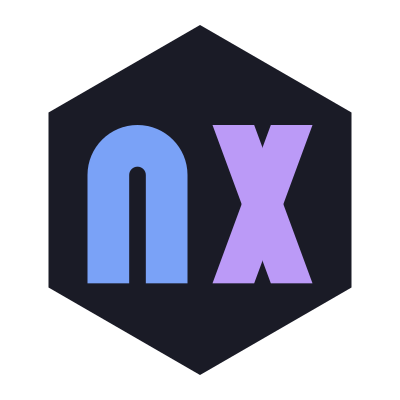

# NX 1.2



NX là ngôn ngữ lập trình mục đích chung, biên dịch tệp `.nx` thành chương trình native qua C++17. Trình biên dịch kiểm tra cú pháp, kiểu và quyền `@cap` trước khi gọi Clang++ hoặc G++. Cú pháp hiện dùng Python AST để phân tích thụt lề; chương trình đã biên dịch không cần Python khi chạy.

Xem [hướng dẫn cú pháp NX](docs/syntax.md), [các tính năng NX 1.1](docs/features-1.1.md) và [Buffer, Python, SIMD của NX 1.2](docs/features-1.2.md).

Xem [hướng dẫn đầy đủ trên Windows](docs/huong-dan-day-du.md) để tạo một `nx.exe`, cài vào PATH, cài extension VS Code/Antigravity, tải thư viện C++/Python và dùng bộ nhớ an toàn trong phạm vi NX hiện hỗ trợ.

[Tải NX 1.2 cho Windows](release/nexir-windows-1.2.0.zip) — gói ZIP chứa `nx.exe`, extension VS Code/Antigravity, ví dụ và tài liệu.

## Bắt đầu

Cần Python 3.10+ và compiler C++17 (`clang++` hoặc `g++`). Trên Windows có thể dùng `py -3 -m nexir` ngay trong thư mục này:

Nếu muốn dùng compiler CLI dạng một file thực thi, chạy `.\scripts\build-windows.ps1` rồi `.\scripts\install-windows.ps1`; máy chạy `nx.exe` không cần cài Python để phân tích `.nx`, nhưng vẫn cần C++ compiler để build/run. `--python` cần một bản CPython bên ngoài.

```powershell
py -3 -m nexir doctor
py -3 -m nexir check examples/hello.nx
py -3 -m nexir run examples/hello.nx
py -3 -m nexir build examples/hello.nx -o build/hello.exe
.\build\hello.exe
```

Cài CLI bằng `py -3 -m pip install -e .` để dùng lệnh `nx` và `nexir`. `nx init myproject` tạo `main.nx`. `nx emit file.nx -o file.cpp` xuất mã C++ để xem. `NEXIR_CXX` chọn compiler C++ khác. Lệnh `build --icon path.ico` đặt icon riêng cho executable Windows; mặc định dùng biểu tượng NX.

## Ngôn ngữ hiện có

- Kiểu: `i32`, `i64`, `f32`, `f64`, `bool`, `str`, `dyn`, `void`.
- Mảng số: `Span[T]` chỉ đọc và `MutSpan[T]` đọc/ghi; phép truy cập `data[i]` kiểm tra biên.
- Hàm, suy luận kiểu biến cục bộ, số học, so sánh, `if`, `while`, `for ... in range(...)`, `break`, `continue`, `return`, `print`.
- `struct` với phương thức/RAII, `owned`/`borrowed`/`mut`, `fn` tĩnh, generic kiểu, trait cơ bản, `SIMD[T,N]`, `parallel_range` và `Result[T]`/`raises`/`try` theo [phạm vi NX 1.1](docs/features-1.1.md).
- `owned[Buffer[T]]` cho bộ nhớ động có RAII, `@py_call` tự sinh wrapper Python và intrinsics AVX2/SSE2 cho [các trường hợp SIMD hỗ trợ](docs/features-1.2.md).
- `Ring[f64]` với kiểm tra chỉ số và thế hệ khi đọc dữ liệu cũ.
- `@export` tạo ký hiệu C ABI trong thư viện chia sẻ. `@extern("symbol")` khai báo hàm C ABI ngoài. CLI hỗ trợ `--cpp`, `--include-dir`, `--library-dir`, `--library` và `--object` để liên kết mã native.

Ví dụ mảng:

```nx
def sum_values(data: Span[f32]) -> f32:
    total: f32 = f32(0)
    for i in range(len(data)):
        total += data[i]
    return total

def main():
    values = [f32(1), f32(2), f32(3)]
    values[1] = f32(4)
    print(sum_values(values))
```

`zeros_f32(n)` và `zeros_f64(n)` cấp phát vùng nhớ và cần `@cap("memory.alloc")`. Mảng cấp phát được giữ sống đến khi chương trình thoát để con trỏ `Span` ổn định.

## Kiểm tra quyền

`@cap` hiện nhận `memory.alloc`, `filesystem.read` và `network.connect`. `read_text(path)` cần cả quyền đọc tệp và cấp phát; `tcp_connect(host, port)` cần quyền kết nối. Hàm gọi phải khai báo đủ quyền của hàm được gọi. Đây là kiểm tra lúc biên dịch, không phải sandbox hệ điều hành.

```nx
@cap("filesystem.read", "memory.alloc")
def main():
    print(read_text("config.txt"))
```

## Kiểm thử và đo tốc độ

```powershell
py -3 -m unittest discover -s tests -v
py -3 benchmarks/bench.py
```

[Phép đo mẫu](benchmarks/results.md) so sánh một vòng lặp số học với Python, Rust và C++. Đây chỉ là kết quả trên một máy và một tác vụ, không chứng minh ưu thế tốc độ tổng quát.

## Giới hạn

NX 1.2 là compiler đang phát triển. `owned`, `Buffer` và `trait` hỗ trợ tập con được mô tả trong [tài liệu NX 1.1](docs/features-1.1.md) và [NX 1.2](docs/features-1.2.md); chưa có borrow checker đầy đủ, sandbox runtime, cú pháp truyền đối số generic tường minh, backend GPU hoặc cấu hình freestanding cho PLC. Kiểm tra biên áp dụng cho phép truy cập mảng trong mã NX; mã ngoài qua FFI phải tự bảo đảm con trỏ hợp lệ. SIMD dùng intrinsics ở các nhánh hỗ trợ, không có bảo đảm vector hóa cho mọi kiểu/chiều rộng. C++17 cần có lúc build; `nx.exe` đã đóng gói frontend Python. Không chạy mã NX không tin cậy trên máy sản xuất.

`List`, `Dict`, `Set`, `Tuple`, `Optional`, `import` nội bộ, f-string và vòng `for` trực tiếp có phạm vi cụ thể trong [hướng dẫn NX 1.2](docs/features-1.2.md). Những cú pháp Python như generator, closure và tham số biến đổi chưa được hỗ trợ.

NX 1.2 có `@cpp_header` + `@cpp_fn` để gọi ký hiệu C++ trực tiếp và `@py_fn` để tự bật bridge/preload Python. Ví dụ: [C++ và NumPy trong một file NX](examples/cpp_python_ffi.nx). Các lời gọi cần quyền `ffi.cpp` hoặc `python.interop` tương ứng.

Logo SVG do người dùng cung cấp được lưu tại [nx-logo.svg](nexir/assets/nx-logo.svg); bản PNG và ICO được tạo từ cùng SVG.
